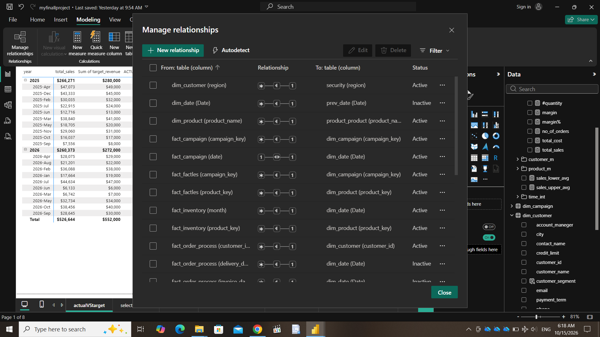
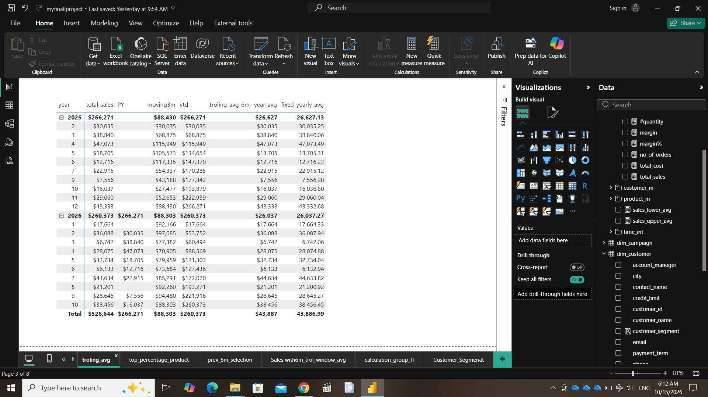
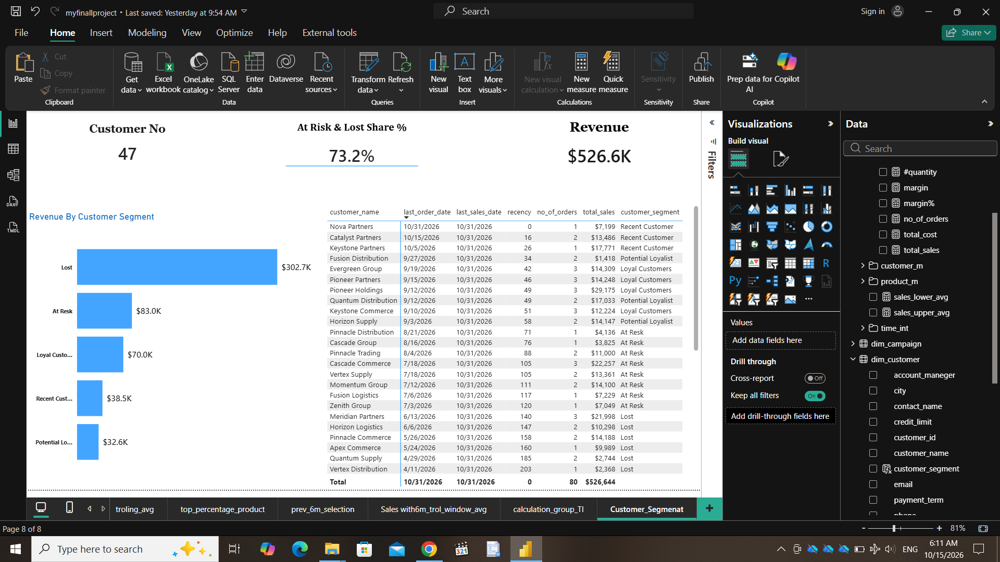
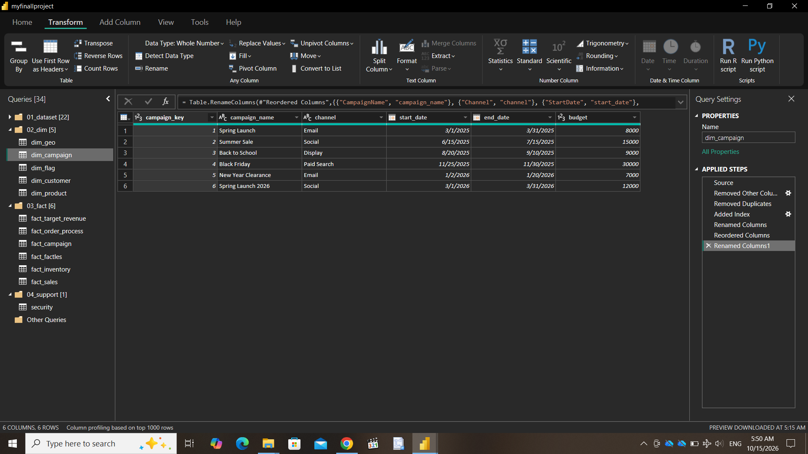
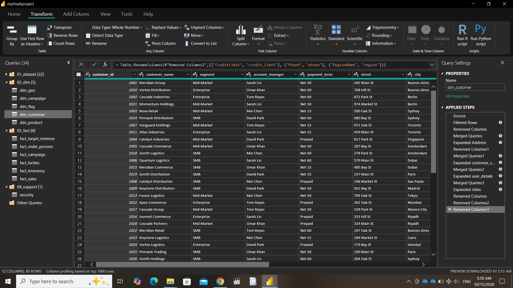
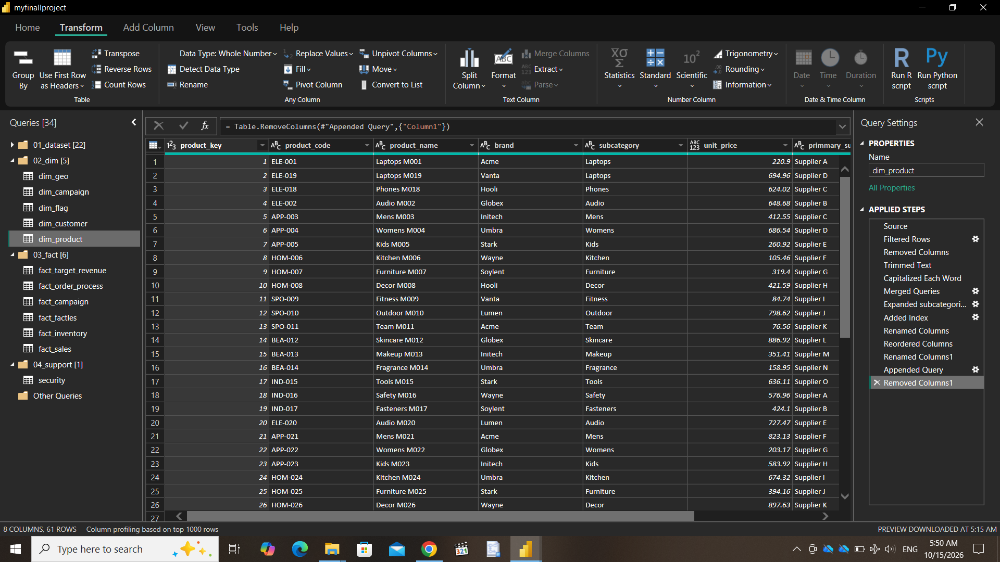
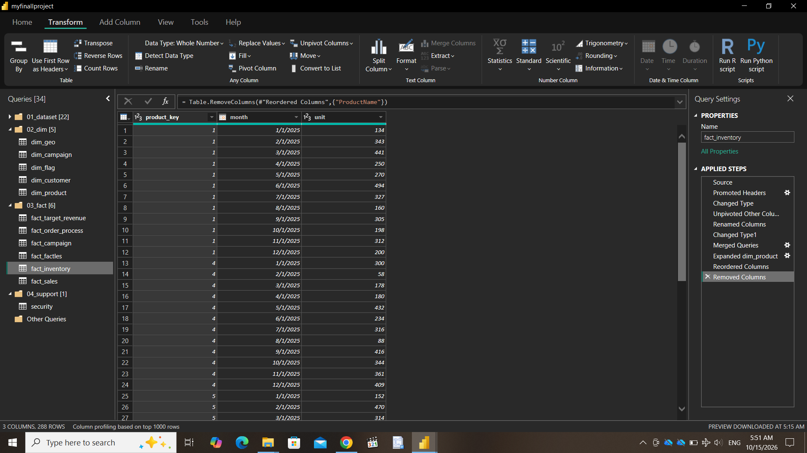
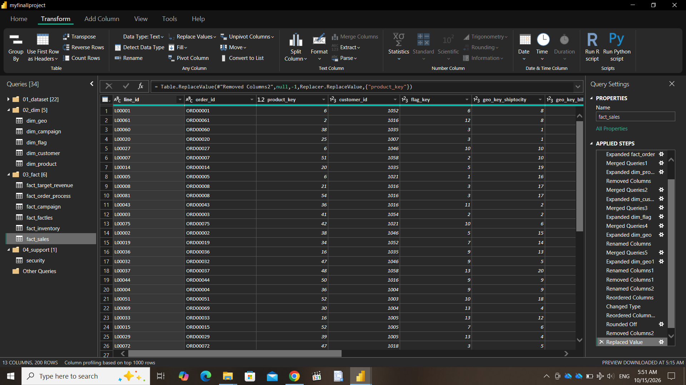
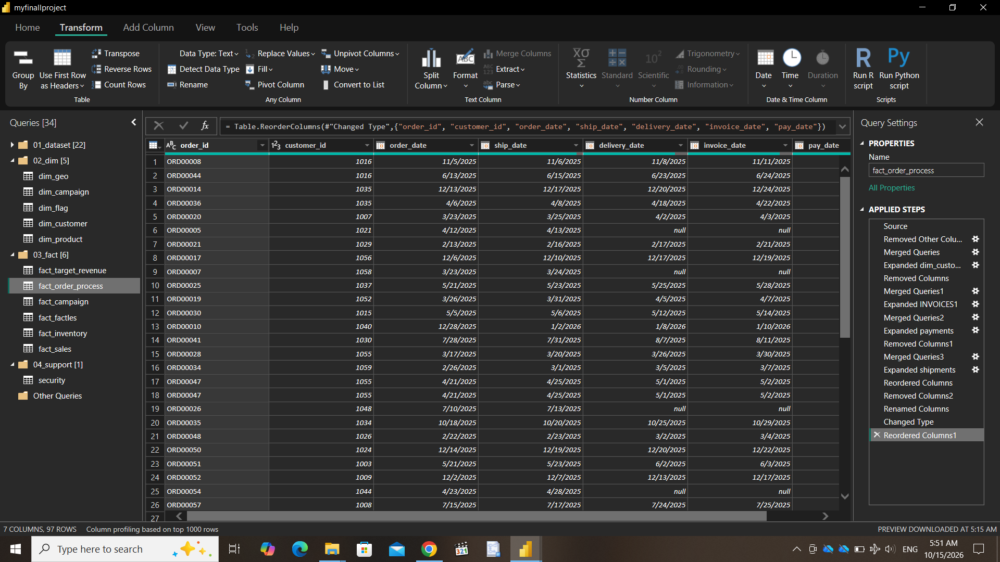

# 🚀 Enterprise Sales, Inventory & Operations Analytics Portfolio

An end-to-end, enterprise-grade business intelligence solution built in **Power BI**, featuring an advanced **Galaxy Star Schema** data architecture, robust **Power Query ETL pipelines**, and a sophisticated **DAX semantic layer** utilizing window functions, dynamic parameters, and role-playing time intelligence.

---

## 📸 Project Screenshots & Visual Gallery

### 1. Model Relationships & Galaxy Star Schema


### 2. Rolling Averages & Time Intelligence


### 3. Customer Segment Cohort Analysis


### 4. Dimension & Fact Table Previews
* **Campaign Dimension:** 
* **Customer Dimension:** 
* **Product Dimension:** 
* **Inventory Fact Table:** 
* **Sales Fact Table:** 
* **Order Process Fact Table:** 

---

## 📊 Executive Summary

This portfolio project models a global enterprise data warehouse environment. It consolidates multi-year sales transactions, monthly inventory snapshots, promotional marketing campaigns, customer master data, and supply chain fulfillment logs into a unified, high-performance analytical model optimized for executive decision-making.

### Key Business Achievements:
* **Unified Cross-Functional Reporting:** Merged disparate operational datasets across Sales, Inventory, Marketing, and Operations into a single Galaxy Schema model.
* **Advanced Financial & Operational DAX:** Developed complex DAX logic for sliding 6-month rolling averages, dynamic Top-N product segmentation with "Others" aggregation, and Pareto (80/20) revenue share analyses.
* **Role-Playing Date Intelligence:** Enabled multi-milestone supply chain tracking (`order_date`, `ship_date`, `delivery_date`, `pay_date`) without dimensional duplication using DAX `USERELATIONSHIP`.

---

## 📐 Data Architecture: Galaxy Star Schema

The data model uses a **Galaxy Schema** (Constellation Schema) where multiple fact tables share conformed dimension tables, ensuring cross-functional consistency across Sales, Inventory, Logistics, and Campaigns.

### Table Inventory & Schema Breakdown

| Group | Table Name | Type | Key Columns | Description |
| :--- | :--- | :--- | :--- | :--- |
| **`02_dim`** | `dim_customer` | Dimension | `customer_id` | Customer profiles, account managers, credit limits, and addresses. |
| **`02_dim`** | `dim_product` | Dimension | `product_key` | Product details, subcategories, brands, unit prices, and suppliers. |
| **`02_dim`** | `dim_calendar` | Dimension | `Date` | Conformed date dimension with month/year sorting indexes. |
| **`02_dim`** | `dim_geo` | Dimension | `geo_key` | Geographic lookup hierarchy (Region, City, Street). |
| **`02_dim`** | `dim_campaign` | Dimension | `campaign_key` | Marketing campaign details, start/end dates, and budgets. |
| **`02_dim`** | `dim_flag` | Junk Dim | `flag_key` | Combined order attributes (`order_channel`, `status`, `priority`). |
| **`03_fact`** | `fact_sales` | Fact Table | `line_id` | Granular order line-item sales, quantities, unit costs, and revenue. |
| **`03_fact`** | `fact_inventory` | Fact Table | `product_key`, `month` | Monthly stock levels per product unpivoted into time-series records. |
| **`03_fact`** | `fact_order_process` | Fact Table | `order_id` | Logistics tracking timestamps (`order_date`, `ship_date`, `delivery_date`, `pay_date`). |
| **`03_fact`** | `fact_target_revenue` | Fact Table | `Period` | Monthly revenue target targets vs. actuals. |
| **`03_fact`** | `fact_factles` | Bridge Table | `product_key`, `campaign_key` | Bridge table connecting promotional campaigns to promoted products. |

---

## 🔄 Power Query ETL Pipeline & Data Governance

1. **Staging & Load Separation:**
   * Organised 22 raw source queries inside a dedicated `01_dataset` staging group with **"Enable Load" disabled**. This prevents uncleaned staging tables from polluting the VertiPaq memory footprint.
2. **Matrix Unpivoting (`fact_inventory`):**
   * Converted raw wide matrix formats into a tall, relational time-series structure using **Unpivot Other Columns**.
3. **Surrogate Key Generation:**
   * Engineered integer surrogate keys (`product_key`, `customer_id`, `flag_key`, `geo_key`) across dimensions to optimize compression and indexing.

---

## ⚡ Complete DAX Semantic Layer & Code Library

### 1. Core Financial Measures

```dax
total_sales = SUM(fact_sales[line_total])
total_cost = SUMX(fact_sales, fact_sales[quantity] * fact_sales[unit_cost])
margin = [total_sales] - [total_cost]
margin% = DIVIDE([margin], [total_sales], 0)
no of orders = DISTINCTCOUNT(fact_sales[order_id])
